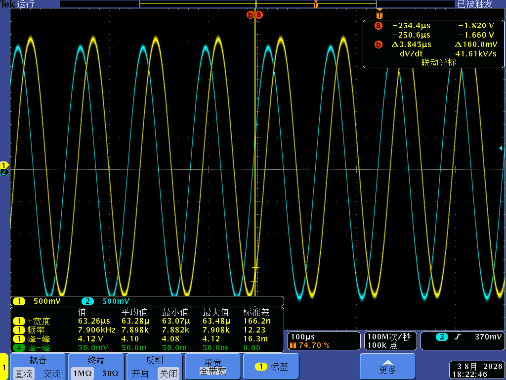

# STM32H743 基础设施 —— 模板 · 自动测试台 · 算法仿真台

<p align="center">
  <em>STM32H743 开发基础设施：带克隆派生工具链的版本化固件模板 + 仪器自动测量台 + PC 算法仿真台</em>
</p>

<p align="center">
  
  
</p>

## 项目简介

本仓库是我 STM32H743 工作的**工程底座** —— 让每块板子的工程可复现、可交接，而不是一次性的：

- **`Templates/`** —— 版本化 H743 固件模板体系（CubeMX + HAL + FreeRTOS/CMSIS-RTOS2 + LVGL 9.5），每套模板自包含，并有冒烟自检脚本把关；新项目一律**克隆派生**，严禁在模板里直接开发。
- **`AutoBench/`** —— Python 自动测量台：按 JSON 测试计划驱动真实仪器（Rigol DG4062 / DS4014E），带严格零仪器 `--dry-run` 模式与 5 Vpp 硬性幅度上限。
- **`SignalHost/`** —— PC 算法仿真台：合成激励 → 引用式接入外部算法源码 → CSV/JSON 结果 → 自动出图与验收。
- **`root/`** —— 原工作区入口文档（人类/AI 协作规约、测量记录）。

> 🇬🇧 English version: [README.md](README.md)

## 核心亮点

- 🧬 **克隆派生工具链** —— `projclone.py`（dry-run 先行、缓存排除、三处改名、校验）+ `template_selftest.py`（关键文件 + configure + build + 中英残留检查）+ `translate_ui.py`（161 条翻译映射重刷）
- 📦 **模板矩阵** —— `H743_LVGL_Baseline`（最小点亮）、`H743_Instrument_CN`/`_EN`（全功能六屏仪器 UI 双语版）、`STM32H743_ZYNQ_DualSPI_Link_Template`，另有刻意保留的 `_deprecated_` 模板作教训存档
- 🔬 **AutoBench 安全优先设计** —— JSON v1 计划、双层幅度限制（计划上限 + 5 Vpp 硬顶）、`--dry-run` 保证零 socket/串口/SCPI、PC 侧计算 Vpp 比值/平坦度/THD/SNR/频率精度，报告输出 CSV + Markdown + JSON + PNG
- 🖥️ **SignalHost 仿真隔离** —— 算法源码经 `SIGNALHOST_CORE_DIR` 外部引用不复制；自带最小 `arm_math.h` 兼容层（仅实现实际用到的 RFFT/SinCos API）；自动验收记录归档
- 📜 **成文纪律** —— 上游同步纪律（signal_separation → 模板）、模板↔模块库回流规则、CN/EN 成对维护

## 技术栈

<div>
  
  
  
  
  
  
  
  
</div>

## 仓库结构

```
Templates/                        # 模板区（只作克隆源，严禁直接开发）
├── H743_LVGL_Baseline/           # 最小点亮：CubeMX + FreeRTOS + LVGL 9.5 + 显示三件套
├── H743_Instrument_CN/ _EN/      # 全功能仪器：六屏 UI、校准、串口遥控
├── LTDC(touch+fmc+LVGL)…Rtos/    # 全功能显示/VCP/SWIO/RTOS 参考工程
├── STM32H743_ZYNQ_DualSPI_Link_Template/
├── signal_separation/            # 活跃上游工程（模板快照的来源）
├── _deprecated_H743_UI_Instrument_20260726/   # 废弃模板留档（教训回溯）
├── _tools/                       # projclone.py / template_selftest.py / translate_ui.py
├── 模板索引.md                    # 模板选择表、版本、同步纪律
└── 工程克隆工具ProjClone_策划案.md
AutoBench/                        # 仪器自动测量台（Python）
├── autobench.py autobench_core/  # 计划加载、频点展开、安全限制
├── instruments/                  # DG4062 / DS4014E 适配器
├── plans/ schema/ examples/ tests/
└── reports/                      # 验收输出（CSV/MD/JSON/PNG）
SignalHost/                       # PC 算法仿真台（C + CMake + Python 工具）
├── src/ compat/                  # host 主程序 + CMSIS API 最小兼容层
├── calibration_host/ cases/ replays/ tools/
root/                             # 工作区入口文档 + 测量记录
├── README.md / CLAUDE.md         # 工程规约（中文）
└── mso4104b_*.{csv,png,json}     # 示波器采集记录
```

## 快速上手

```bash
# 从模板派生新工程（先 dry-run 过目！）
python Templates/_tools/projclone.py --src Templates/H743_Instrument_CN \
    --dst ../MyExp --new-name MyExp --profile template-derive
cd ../MyExp && cmake --preset Debug && cmake --build build/Debug -j8

# AutoBench 零仪器验证：
python -B AutoBench/autobench.py --plan AutoBench/plans/bode_100_1M.json --dry-run
# AutoBench 20 点模拟幅频：
python -B AutoBench/autobench.py --plan AutoBench/plans/bode_100_1M.json --simulate \
    --output-dir reports/acceptance_bode
```

## 文档

- 工作区规约（人类入口）：[root/README.md](root/README.md) · AI 规约：[root/CLAUDE.md](root/CLAUDE.md)
- 模板索引与同步纪律：[Templates/模板索引.md](Templates/模板索引.md)
- AutoBench 手册：[AutoBench/README_使用说明_UTF-8.md](AutoBench/README_使用说明_UTF-8.md)
- SignalHost 手册：[SignalHost/README_使用说明_UTF-8.md](SignalHost/README_使用说明_UTF-8.md)

## 许可证

以 **MIT License** © 2026 TZH-user 发布，详见 [LICENSE](LICENSE)。STM32 HAL/CMSIS/FreeRTOS/LVGL 等第三方库遵循其上游许可证。
