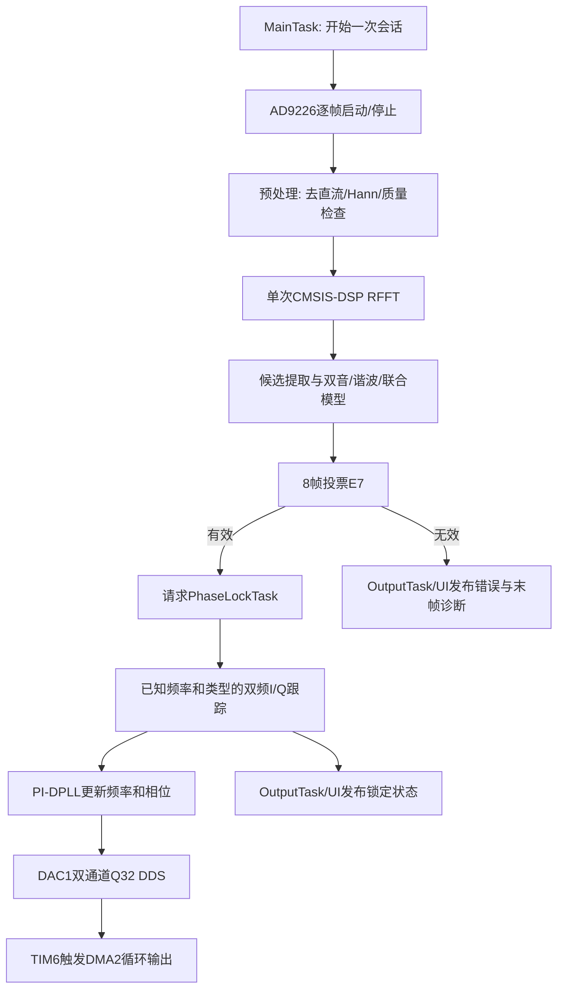

# signal_separation 工程开发复盘与架构评估报告

## 0. 报告范围与结论标记

- 工程：`F:\STM32\stm32project\VSCodeCMAKEProject\signal_separation`
- MCU：STM32H743XIH6
- 当前分支：`feature/dual-phase-lock`
- 复盘基线：`1b68802 fix: 隔离DAC DMA并平滑双分量锁相`
- 架构抽离与资料收敛更新：`2892434` 之后的当前工作区
- 日期：2026-07-24

本文使用以下标记区分结论强度：

- **已验证**：由源码、Map、CubeMX、构建、串口、GDB或真机测试直接支持。
- **经验判断**：符合嵌入式工程经验，但尚未完成本工程专项实验。
- **建议**：后续可以做，不代表当前必须修改。

### 总结

当前工程已经形成“CubeMX外设框架 + BSP驱动 + 纯算法模块 + RTOS任务调度 + 单一输出通道 + UI适配 + 运行诊断”的分层结构。一次识别和持续锁相已经分开，FFT不会连续运行，DAC输出消失的根因也从“怀疑计算超时”进一步定位到DMA1传输错误，并通过DMA2隔离解决。

**综合评价：**

- 当前功能完成度：8/10。
- 当前解耦和可维护性：7/10。
- 电赛四天三夜适用性：8/10，前提是冻结主架构，不在比赛中继续大拆分。
- 长期产品化适用性：6/10，还需要清理停用文件、拆分过大的输出模块、增加主机算法测试和自动化验收。

---

## 1. 本次工程的软件架构

### 1.1 分层结构

| 层级 | 主要目录 | 当前职责 | 评价 |
| --- | --- | --- | --- |
| CubeMX生成层 | `Core`、`Drivers`、`Middlewares`、`.ioc` | 时钟、GPIO、DMA、DAC、TIM、USART、FreeRTOS对象和中断入口 | 外设配置已回归`.ioc`管理，方向正确 |
| BSP层 | `BSP/ADC`、显示和触摸底层 | AD9226采集、LCD、触摸等具体硬件访问 | 硬件相关性明确，可作为平台适配边界 |
| 配置层 | `APP/Config`及各模块`*_config.h` | 采样、分析、输出、内存、锁相和DAC参数 | 基本集中，但跨模块一致性仍依赖人工 |
| 算法层 | `APP/SignalDetect`、`APP/Math`、`APP/PhaseLock` | 预处理、FFT、候选、分类、联合模型、投票、PI-DPLL、查表 | 大部分不直接承担任务调度，可复用性较好 |
| 设备服务层 | `APP/DacOutput`、`APP/Debug` | 双DAC DDS、DMA补数、串口环形缓冲、RTOS资源诊断 | 接口清楚，硬件依赖仍可进一步注入化 |
| RTOS调度层 | `APP/RTOS` | 一次识别、持续锁相、输出、显示、触摸任务 | 任务职责已基本按所有权划分 |
| UI适配层 | `UI/Adapter`、`UI/Custom`、`UI/Port` | 把算法快照转换为页面数据，管理LVGL端口和页面 | UI不直接进入算法热路径，合理 |
| 证据和交付层 | `Docs`、工程记录文件 | 真机日志、阶段报告、工具异常和回滚依据 | 证据较完整，但文档数量已经偏多 |

### 1.2 当前任务体系

CubeMX创建5个用户任务，运行时连同FreeRTOS内部任务共观测到8个任务。

| 任务 | 相对优先级 | 主要职责 | 不应该承担的职责 |
| --- | ---: | --- | --- |
| `PhaseLockTask` | 40，最高 | 持续AD9226短帧采集、已知双分量I/Q跟踪、PI-DPLL、DAC补数事件 | 不重复FFT和四模型完整搜索 |
| `MainTask` | 32 | 停止旧会话、一次多帧采集识别、请求锁相启动 | 不持续补DAC，不直接拥有串口 |
| `DisplayTask` | 24 | 初始化显示和LVGL，周期运行UI | 不读取触摸I2C，不运行分析算法 |
| `TouchTask` | 8 | 等待触摸中断、读取GT9xx、更新输入状态 | 不刷新页面和串口 |
| `PrintfTask` | 8 | 独占正式串口输出和格式化结果 | 不控制ADC、FFT或DAC |

### 1.3 主数据流



### 1.4 一次识别和持续跟踪的边界

**已验证：**

1. FFT只在`MainTask`的一次识别阶段执行，不连续运行。
2. E7有效后把两个频率和波形类型作为跟踪种子交给`PhaseLockTask`。
3. 跟踪阶段只做已知双频I/Q估计，不再运行完整候选搜索、谐波分类和联合模型细化。
4. DAC半传输和全传输中断只投递线程标志，实际补数在任务上下文执行。
5. `PrintfTask`是正式串口的单一所有者，算法任务通过发布接口提交数据。

---

## 2. 异常点与解决办法

### 2.1 运行和算法异常

| 异常现场 | 根因或最终判断 | 排查方法 | 解决办法 | 状态 |
| --- | --- | --- | --- | --- |
| 串口看不到ADC波形 | 输出模式、单帧提交时机和串口所有权不清晰 | 对比来源工程，核查`app_output_config.h`和任务调用链 | 恢复配置层输出模式；MainTask只提交一帧；PrintfTask独占串口 | 已解决 |
| 实际只需一次FFT，却出现持续分析倾向 | 识别阶段和跟踪阶段职责没有先明确 | 重新定义主线状态和验收输出 | FFT只在一次捕获中运行；持续阶段改用已知模型跟踪 | 已解决 |
| 调度文件过长、任务逻辑分散 | 早期把调度、执行和输出混在同一管线文件 | 按函数调用者和任务所有权审计 | 独立Main/Output/Display/Touch/PhaseLock任务文件，CubeMX弱入口由用户强符号覆盖 | 基本解决 |
| 识别结果存在但UI未显示波形类型 | 最终投票无效时UI只显示UNKNOWN，末帧诊断未利用 | 对比E5末帧结果、E7有效性和UI快照 | 有效时显示E7；单候选无效时显示明确标记的E5末帧诊断 | 已解决 |
| 未连接加法器时双音识别失败 | 第二路物理信号没有进入AD9226，不是算法故障 | 仪器状态、串口候选和物理接线交叉验证 | 连接OPA690加法器后重新验收，避免继续调算法阈值 | 已解决 |
| 完整锁相跟踪每帧约21.87 ms | 跟踪阶段重复执行联合模型细化和残差重构 | 增加子阶段测时，比较5.12 ms DAC窗口 | 跟踪改为一次双频I/Q相关，锁相帧降到约0.8 ms | 已解决 |
| 逐点`sinf/cosf`导致实时计算偏重 | E4/E5等热循环中存在逐点三角函数 | 源码审计、符号检查和真机测时 | 复用CMSIS表，振荡器只查一次步长后递推乘加；热文件局部`-O3` | 已解决 |
| DAC长时间后概率消失 | 最终现场为`HAL_DMA_ERROR_TE=0x1`，不是缓冲计算超时 | 增加NDTR/CR/FCR/LISR/DMA错误快照；逐项改变优先级、FIFO、内存bank和采样率 | DAC从`DMA1_Stream2`迁移到`DMA2_Stream0`，与ADC/USART隔离 | 已解决 |
| DAC停止后仍显示`LOCK=1` | 锁相状态和DAC运行状态没有同步收口 | 复现欠载后对比两个状态快照 | PhaseLockTask检测DAC停止后立即记录错误并结束会话 | 已解决 |
| 示波器观察抖动明显 | 原PI增益偏激进，块级相位测量本身有噪声 | 观察相位误差、频率步进和锁定状态 | P由0.45降至0.12，I由0.20降至0.05，单帧步进由5 Hz降至1 Hz；不加放大噪声的D项 | 数字侧已验证，模拟侧待最终观察 |

### 2.2 CubeMX和工程配置异常

| 异常现场 | 原因 | 解决办法 | 状态 |
| --- | --- | --- | --- |
| `.ioc`在CubeMX加载时发生TFBGA240 `BGAPackage$GBall`崩溃 | 手工追加PA4/PA5引脚索引和共享信号映射与包映射不兼容 | 从可加载副本合并正确的`Mcu.IP`顺序、PA4/PA5物理索引和`SH.COMP_DAC*`映射 | 已解决 |
| DAC/DMA早期由用户代码临时补齐 | CubeMX无法可靠加载时只能先保持最小运行闭环 | 修复`.ioc`后重新生成，DAC、DMA、NVIC和TIM6重新交由CubeMX管理 | 已解决 |
| CubeMX真实生成成功，CLI仍返回失败 | 后检查固定要求不存在的`Core/Inc/freertos.h`，并混入广告网络错误和成功标记顺序问题 | 以进程码、`OK/project generate`、文件差异和后续构建联合判断；工具缺陷另行报告 | 工程已绕过，工具待修 |
| HOTPLUG擦除失败 | 目标运行态与擦除/复位时序不兼容 | 改用Under Reset、SWD 1 MHz；不Mass Erase、不改Option Bytes | 已解决 |

### 2.3 输出、串口和调试异常

| 异常现场 | 原因 | 解决办法 | 状态 |
| --- | --- | --- | --- |
| 串口读到历史数据或空数据 | ST-Link VCP缓存、打开时机、DTR/RTS和端口重连边界不清楚 | 增加clear/preserve模式、DTR/RTS显式参数、首字节和读错误统计 | 大部分解决 |
| `vcp-list`超时但COM3可直读 | Windows设备枚举路径阻塞 | 用CIM确认端口，对已知COM3直接执行有界`vcp-read` | 有绕过，工具待修 |
| GDB读取后DAC立即停机 | `monitor halt`暂停CPU十余秒，外设仍继续运行，必然错过DAC补数 | 长期验收改用8 Mbps串口；GDB只读资源，读完立即硬件复位 | 已明确边界 |
| GDB报告`Undefined item: UTF-8` | 当前Arm GDB不支持CLI默认发送的字符集项 | 将字符集错误视为warning，不否定变量读取；工具端应探测能力 | 工具待修 |
| 串口助手占用COM3 | 两个进程不能同时独占同一COM端口 | 每轮测试前明确“已释放/正在占用”，自动工具使用有界时间 | 流程解决 |

---

## 3. 需要修复或维护的工具、原因与事故现场

### 3.1 高优先级：`cubemx-ai-cli`

**事故现场：**

1. CubeMX曾明确输出`KO`和Java异常，但旧版本CLI仅依据退出码和静态文件存在性误报成功。
2. 后续CubeMX明确生成成功、目标文件正确更新、构建通过，CLI又因不存在的`Core/Inc/freertos.h`误报失败。
3. `success_marker_found=false`未兼容`OK -> project generate`和`project generate -> OK`两种顺序。
4. CubeMX首页广告请求错误被混入生成结果。

**需要修复：**

- 成功判定同时使用独立`KO`、异常摘要、进程码、明确成功标记、关键文件变化和后续post-check。
- 根据CMSIS-RTOS模式动态决定是否期待`freertos.h`。
- 把广告、登录WebView等非生成网络异常降级到独立warning。
- 返回“CubeMX内部异常”和“生成产物是否可用”两个状态，不能只给一个`ok`。

### 3.2 高优先级：`stm32-build-ai`串口枚举

**事故现场：**

- `vcp-list --json`在15秒后超时并给出空列表；同一时刻Windows CIM能找到COM3，`vcp-read COM3 @ 8 Mbps`连续120秒读取60038字节、零读取错误。

**需要修复：**

- 设备枚举增加可配置超时和部分结果返回。
- Windows上在CIM、SetupAPI和pyserial之间做有界回退。
- 枚举失败时明确提示“已知端口仍可直接读取”。

### 3.3 中优先级：`stm32-build-ai` GDB包装

**事故现场：**

- 自动发送`set host-charset UTF-8`和`set target-charset UTF-8`，当前GDB返回`Undefined item`。
- `gdb-eval`默认暂停内核，连续DAC系统会因此产生人为欠载。

**需要修复：**

- 先查询GDB字符集能力，或只在用户指定时设置。
- 在帮助和JSON中增加`halts_target=true`、`real_time_side_effect=true`。
- 对实时固件提供“停止业务后读取”提示，不应自动把调试造成的欠载归因于固件。

### 3.4 中优先级：STM32CubeMX安装版本

**事故现场：**

- 当前实际版本为6.17.0-RC5，出现BGA包解析异常、广告线程错误和浏览器线程异常。

**建议：**

- 比赛电脑优先保留已验证的稳定版CubeMX，并固定FW_H7 V1.13.0。
- RC版本只能作为兼容验证环境，不应作为比赛当天唯一生成器。
- 安装或切换版本前保留`.ioc`、生成代码和Git提交，禁止直接覆盖唯一工程。

### 3.5 中优先级：实验室仪器MCP/skill注册链路

**事故现场：**

- skill文件存在但MCP工具未加载时，无法控制已知IP仪器；重新注册后才恢复。
- DG4062三角波在工具枚举中使用`RAMP`，不是用户自然语言中的`TRI/TRIANGLE`。

**需要修复：**

- 启动时提供list/probe/status的健康检查和清晰的未注册提示。
- 波形枚举增加自然语言别名，但最终仍回读实际SCPI状态。
- 工具未加载时禁止悄悄退回未经门控的原始socket写命令。

### 3.6 低优先级：CodeGraph工作区管理

**事故现场：**

- `.codegraph/`持续作为未跟踪目录出现，容易污染Git状态，但它本身对跨文件审计很有价值。

**建议：**

- 明确选择：加入工程`.gitignore`，或者用全局Git exclude忽略；不要提交索引数据库。
- 保留索引生成方式文档，使其他AI能复现，而不是复制索引目录。

---

## 4. 技术实现、遇到的问题和解决方法

### 4.1 一次信号识别

1. AD9226以2.048 MS/s采集4096点帧。
2. 预处理完成低12位提取、均值/直流估计、RMS、峰值、削顶检查、去直流和Hann窗。
3. CMSIS-DSP `arm_rfft_fast_f32`运行4096点RFFT。
4. 功率谱估计噪声底，在1～100 kHz范围按配置产生候选。
5. 双正弦、谐波特征和联合模型共同判断两路成分和SINE/TRIANGLE类型。
6. E7对8帧做频率和类型投票，降低单帧噪声和候选抖动。

**关键问题：**三角波谐波会形成额外FFT候选，不能把“候选数”直接等同于“物理信号数”。解决方法是用谐波特征和联合模型解释候选，而不是只取最大的两个峰。

### 4.2 持续锁相

1. 首次识别给出两路名义频率和波形类型。
2. 每20 ms采集一帧4096点数据，帧长约2 ms。
3. 对两个已知频率做I/Q相关，得到幅度和相位。
4. 由帧完成时刻回推帧首采样时刻，统一ADC测量和DAC输出的系统时基。
5. PI-DPLL更新：相位比例增益0.12，频率积分增益0.05，单帧频率步进限制1 Hz，名义频率附近限制正负200 Hz。
6. 不使用D项，因为块级相位误差包含ADC噪声、模型误差和帧时间戳扰动，差分会放大高频噪声。

**关键问题：**早期跟踪重复跑完整联合模型，21.87 ms耗时远超DAC补数窗口。通过阶段测时定位后，持续路径改为已知频率I/Q，处理时间降到约0.8 ms。

### 4.3 双DAC波形重构

1. DAC1 OUT1/OUT2使用同一个32位打包点，低16位和高16位分别送两路12位DAC数据寄存器。
2. TIM6以1.6 MS/s产生更新触发。
3. 32768点双通道缓冲分成两个16384点半缓冲，单个半缓冲时限10.24 ms。
4. Q32相位累加器支持任意细分频率，不要求波形表整周期闭合。
5. 正弦直接查询CMSIS Q15表并插值；三角波用定点分段计算。
6. DMA回调只通知任务补充已经消费的半缓冲，并执行DCache clean。

**关键问题：**即使最大补数只有约2.865 ms，DMA1仍概率报TE并使DAC停止。通过增加故障快照、控制变量实验和120秒测试，最终确认迁移到DMA2后稳定，而不是继续扩大缓冲。

### 4.4 内存和实时性

- DAC缓冲位于RAM_D2 `0x30000000`，大小`0x20000`，处于DMA可达区。
- `.fft_buffer`等大型算法工作区单独放置，避免挤占任务栈。
- 数值热文件局部`-O3`，任务、UI和驱动仍保持Debug可调试性。
- 真机最小堆余量7256 B。
- Printf/Main/PhaseLock最少剩余栈分别为105/123/402 words。
- 120秒内有效帧增加5200，`INVALID/OVERRUN/UNDERRUN/DMA_ERR`均为0。

---

## 5. 关键技术清单

1. STM32H743多DMA控制器的流量隔离和DMA可达内存布局。
2. DCache一致性处理和32字节对齐。
3. CMSIS-DSP 4096点实数FFT、功率谱、噪声底和候选提取。
4. 双正弦模型、谐波特征、三角波分类和联合模型消歧。
5. 8帧频率/类型投票和错误原因位图。
6. 已知双频I/Q相关和块级PI-DPLL。
7. ADC帧时间戳回推与DAC统一系统时基。
8. Q32相位DDS、双DAC 32位打包和双半缓冲动态补数。
9. CMSIS正弦表复用、递推振荡器和局部编译优化。
10. RTOS任务所有权、线程标志、信号量和单一串口输出者。
11. CubeMX弱任务入口由独立用户强符号覆盖，避免再生成覆盖业务代码。
12. 串口非侵入遥测、GDB资源快照、Fault寄存器和故障现场保存。
13. Git分支、阶段提交、`.ioc`备份和真机验收记录。

---

## 6. 可以抽离并在其他工程复用的代码或算法

不是所有算法都应该包装成RTOS任务。纯算法优先抽成静态库；只有需要长期持有硬件或异步事件的功能才适合任务化。

| 候选 | 推荐交付形态 | 直接依赖 | 复用评价 | 抽离前需要处理 |
| --- | --- | --- | --- | --- |
| `APP/Math/app_trig_lookup.*` | 纯C模块/静态库 | CMSIS-DSP表 | 很高 | 明确表版本和插值精度 |
| `signal_preprocess.*` | 纯算法库 | 配置、工作缓冲 | 高 | 将全局工作区改为调用者传入上下文 |
| `signal_fft.*` | CMSIS-DSP算法库 | CMSIS-DSP、配置 | 高 | 把全局候选和功率谱改为显式context |
| `signal_dual_sine.*` | 纯算法库 | FFT结果、查表模块 | 高 | 固化输入/输出数据结构版本 |
| `signal_harmonic.*` | 纯算法库 | 预处理、候选 | 高 | 将题目阈值从算法中完全参数化 |
| `signal_joint_model.*` | 纯算法库 | 多个信号模型 | 中高 | 拆分“比赛题模型”和“通用跟踪接口” |
| `signal_vote.*` | 通用多帧决策模块 | 波形类型结构 | 中高 | 把双分量数量和阈值配置化 |
| `APP/PhaseLock/app_phase_lock.*` | PI-DPLL算法库 | 时间戳、跟踪测量 | 高 | 去掉对DAC频率边界宏的直接依赖，改为配置结构体 |
| `APP/DacOutput/app_dac_output.*` | H743双DAC DDS服务 | HAL DAC/TIM/DMA、CMSIS-RTOS | 中高 | 注入HAL句柄、DMA控制器和内存区；不要硬编码DMA2 LISR |
| `APP/Debug/debug_io.*` | 通用UART DMA输出服务 | HAL UART | 高 | 将环形缓冲大小和回调所有权参数化 |
| `app_rtos_diagnostics.*` | FreeRTOS诊断模块 | 任务句柄、输出统计 | 中高 | 任务列表改为注册表，不直接引用本工程句柄 |
| `BSP/ADC/ad9226.*` | AD9226平台驱动 | TIM2、DMA、GPIO映射 | 中 | 把定时器、DMA和引脚封装成板级配置 |
| `app_phase_lock_task.*` | `SignalTrackingTask`模板 | ADC、DAC、PI-DPLL、RTOS | 中 | 用接口表替代直接调用具体BSP；保留任务所有权模式 |
| `app_output_task.*` | 输出任务框架 | 所有结果结构、UART | 当前较低 | 文件过大，先拆成队列核心、日志格式器和波形流三个模块 |

### 推荐的可移植包结构

```text
SignalCore/
  include/
    signal_context.h
    signal_preprocess.h
    signal_fft.h
    signal_models.h
    signal_vote.h
    phase_lock.h
  src/
  tests/

Stm32SignalAdapters/
  ad9226_hal_adapter.c
  dual_dac_dma_adapter.c
  cmsis_rtos_tracking_task.c
  uart_dma_output_task.c
```

### 最值得先抽离的三个成果

1. `SignalCore`纯算法库：不依赖RTOS和具体外设，最容易跨工程复用和做PC测试。
2. `dual_dac_dma_adapter`：保留Q32 DDS、双半缓冲和DCache处理，但外部注入HAL资源。
3. `cmsis_rtos_tracking_task`：复用“事件驱动补数 + 周期短帧跟踪”的任务骨架，不复制本工程全部业务。

---

## 7. 解耦性、管理质量和电赛短周期适用性

### 7.1 当前做得合适的部分

1. `.ioc`重新成为外设、DMA、NVIC和任务的配置源。
2. 用户业务代码位于独立`APP`文件，避开CubeMX覆盖区。
3. MainTask和PhaseLockTask按“一次识别/持续跟踪”分权。
4. 串口只有一个正式所有者，避免多个任务同时打印。
5. UI通过Adapter读取快照，不直接控制ADC和算法。
6. DMA中断只做通知，重计算放在任务上下文。
7. Git分支和阶段提交替代整工程复制备份。
8. 有Map、串口、GDB、Fault和工具异常证据，不只以编译通过作为验收。

### 7.2 管理风险处理状态

1. **旧实现混淆：已解决。**旧 `app_signal_pipeline`、`app_adc_task` 和
   `app_fft_task` 已退出当前目录，历史版本统一从 Git 查看。
2. **输出任务过大：已解决。**队列核心、日志格式化和 ADC/FFT 波形流已拆为
   `app_output_task.c`、`app_output_log_formatter.c` 和
   `app_output_wave_stream.c`，外部接口不变。
3. **配置一致性依赖人工：已降低。**`APP/Config/app_config_contracts.h`
   已加入帧长、FFT 点数、频率边界、DAC 缓冲、TIM6 分频和输出队列容量断言；
   `.ioc` 与运行期硬件状态仍需共同验收。
4. **文档数量增长过快：已收敛。**阶段截图、原始串口/GDB 摘录和中间报告
   已从当前目录移除，`README_UTF-8.md` 与
   `Docs/当前主线索引_UTF-8.md` 作为两级入口，历史证据由 Git 保存。

### 7.3 是否适合四天三夜

**结论：适合，但需要使用“冻结主线”的比赛策略。**

建议比赛版本按以下节奏：

1. 第一天：CubeMX/BSP、ADC单帧、串口和屏幕最小闭环。
2. 第二天：离线算法、FFT、分类和固定测试矩阵。
3. 第三天：持续跟踪、DAC、性能和边界工况。
4. 第四天：只做阈值、UI、校准、报告和回归，不再改任务架构。

比赛期间允许的改动：

- 参数、阈值、校准、日志字段和小范围故障修复。
- 独立模块内部优化，接口不变。

比赛期间应冻结的内容：

- 任务数量和所有权。
- ADC/DAC DMA控制器分配。
- 主结果结构和串口协议。
- 内存段和大型缓冲布局。
- CubeMX版本和固件包版本。

---

## 8. 用户协作中不利于开发的行为，以及改进建议

本节不是评价个人，而是总结哪些输入会增加技术歧义和重复验证。

### 8.1 硬件状态变化有时通知较晚

**现场：**加法器未连接、AD9226前级幅度调整、信号源频率改变、串口助手占用等状态曾在算法排查之后才确认。这会让AI先怀疑算法、DMA或阈值，浪费一次排查周期。

**建议：**每次真机测试前固定发送一行：

```text
硬件：CH1=三角35k/0.15Vpp/ON，CH2=正弦70k/0.05Vpp/ON，OPA690已连接，AD9226前级不变，COM3已释放。
```

### 8.2 “继续”“执行”有时缺少阶段指向

长对话中同时存在E1～E9、FPGA、DAC、锁相和UI支线，单独一句“继续”可能有多个合理解释。

**建议：**写成：

```text
继续锁相阶段：从当前Git提交开始，先完成DMA稳定性，不修改UI。
```

### 8.3 架构约束有时在实现后才具体化

“主任务要简单”“三步完成”“不要过度抽象”方向正确，但不同人对“简单”的理解不同。早期若没有伪代码，AI可能把必要错误处理也理解成应该隐藏或删除。

**建议：**在任务开始时提供希望看到的顶层伪代码：

```c
start_capture();
stop_capture();
publish_result();
```

并补充一句：允许子函数内部保留超时、错误处理和状态收口。这样既能保持顶层清晰，也不会牺牲可靠性。

### 8.4 验收标准曾多次动态变化

例如从“看到ADC波形”扩展到“一次FFT”“1～100 kHz接口”“波形分类”“锁相”“双DAC输出”。动态扩展本身正常，但如果不声明新阶段，旧实现会被误认为方向错误。

**建议：**每次扩展用三行描述：

```text
新增阶段：持续锁相。
保持不变：一次FFT和现有UI协议。
新验收：两路LOCK=1，DAC连续120秒不停止。
```

### 8.5 测试时限压缩需要同时指定覆盖取舍

“15分钟以内”能提高效率，但需要说明哪些旧数据允许复用、哪些边界必须重测。后期已经采用“旧证据不重复、只补缺口”的方式，效果较好。

**建议：**明确：

- 必测项。
- 可引用历史项。
- 允许省略项。
- 到时仍失败时是停止还是继续。

### 8.6 授权和端口所有权越早集中越好

后期给出“除硬件变更外无需重复授权”明显减少了等待。对烧录、仪器输出、串口和Git提交，建议每个阶段开始时一次性说明授权范围和安全边界。

### 8.7 有帮助的协作行为

以下行为对开发明显有帮助，应继续保持：

- 明确反对过度抽象并要求任务文件同名、职责独立。
- 发现UI卡死、DAC消失和示波器异常后及时报告真实现象。
- 主动说明硬件接线、仪器IP、前级幅度和串口占用。
- 要求阶段提交Git、保留`.ioc`管理和真机资源数据。
- 允许在已有证据充分时自行执行后续测试，减少无意义等待。

### 8.8 推荐的以后协作模板

```text
目标：
当前Git分支/提交：
硬件与仪器状态：
输入信号：
期望输出：
允许修改范围：
禁止事项：
验收指标和持续时间：
允许的硬件动作：
完成后需要的交付物：
```

---

## 9. 电脑环境中经常导致浪费时间的问题

### 9.1 CubeMX版本和路径不统一

- 文档偏好版本、工具`help-ai`历史路径和实际安装的6.17.0-RC5不一致。
- 工具需要先发现可执行文件和固件包仓库。

**建议：**固定一份比赛环境清单，记录CubeMX、CubeProgrammer、Arm GNU、CMake、Ninja、OpenOCD、FW_H7和绝对路径。

### 9.2 RC版本的非确定性错误

CubeMX广告、WebView、BGA解析和生成后检查会产生大量与固件结果无关的错误文本，AI需要额外判断真假失败。

**建议：**比赛使用稳定版；关闭不必要联网功能；以Git差异和构建作为生成后的硬门禁。

### 9.3 串口占用和Windows枚举慢

- 串口助手与自动测试互斥。
- `vcp-list`可能超时，但直接COM3读取正常。

**建议：**固定COM号和波特率；测试前明确释放；枚举只作为辅助，不作为已知端口读取的前置条件。

### 9.4 缺少ST-LINK_gdbserver

构建和OpenOCD路径可用，但工具诊断长期报告可选GDB Server缺失，容易被误解为整个调试环境损坏。

**建议：**默认记录“xPack OpenOCD为正式调试后端”，ST-LINK_gdbserver只作为可选能力。

### 9.5 GDB暂停不适合当前实时系统

这不是电脑性能不足，而是调试方式与连续DMA输出冲突。若不知道该边界，会反复制造同一种假故障。

**建议：**串口/SWO/示波器用于实时验收，GDB只做短快照；读完重置业务状态。

### 9.6 PowerShell默认编码

未显式指定`-Encoding UTF8`时，中文Markdown可能显示乱码，增加阅读和误修改风险。

**建议：**所有中文文件名保留`_UTF-8`，PowerShell读取显式使用UTF-8，编辑后做严格UTF-8解码检查。

### 9.7 `rg`被系统拒绝

常用快速检索不可用，必须改用`Get-ChildItem`和`Select-String`，复杂目录扫描更慢。

**建议：**继续使用CodeGraph处理源码调用链，PowerShell只做确定文件的文本检索；不要为比赛临时修改系统安全策略。

### 9.8 多盘符路径和知识库路径漂移

规则文档中仍存在D盘历史路径，而实际有效路径为E盘；工具链、工程、CubeMX和仪器日志分布在C/E/F盘。

**建议：**维护一份当前机器路径索引，标记“现用”和“历史”，避免AI先访问失效路径。

### 9.9 `.codegraph`长期显示未跟踪

虽然没有被提交，但会让每次`git status`都出现额外噪声。

**建议：**在用户确认后加入忽略规则；索引始终本地重建。

### 9.10 物理实验缺少统一状态快照

AI能控制部分仪器，但无法自动确认加法器供电、线缆、跳线和模拟前级旋钮。

**建议：**每次更改硬件后拍一张接线照片，或维护一份简短的实验台状态文件并注明更新时间。

---

## 10. 补充建议

### 10.1 先做一个“当前主线索引”

当前最缺的不是更多阶段报告，而是一份快速入口。入口应只包含：

- 当前Git基线。
- 当前任务和所有权。
- 当前输入/输出接口。
- 当前正式验收报告。
- 停用文件列表。
- 剩余两三个风险。

### 10.2 串口启动信息加入固件身份

建议以后输出：

```text
FW_ID=signal_separation
GIT=1b68802
BUILD=Debug
CONFIG=DAC_1P6M_DMA2_PI
```

这样能直接排除“是否烧错程序”的疑问。比赛中可以手工维护短版本号，不必把完整Git自动化做得很复杂。

### 10.3 为纯算法增加PC回归测试

至少保存以下输入向量和期望结果：

- 单正弦：20/50/100 kHz。
- 单三角：30/80 kHz。
- 双正弦、正弦+三角、强弱路、近频路。
- 低幅、削顶、缺一路和噪声。
- PI-DPLL的固定频偏、相位阶跃和噪声输入。

这样阈值和算法优化可以先在PC完成，再上板确认实时性。

### 10.4 不要把所有可复用能力都做成任务

任务会引入栈、优先级、同步和所有权成本。推荐原则：

- 纯数学：函数/上下文对象。
- 独占硬件：服务模块。
- 长期异步流程：RTOS任务。
- 多个任务都需要的结果：只读快照或消息队列。

### 10.5 产品化前增加故障恢复策略

当前DMA2隔离已稳定通过测试。若以后做长期无人值守产品，可以增加一次有界DAC重启和重启次数遥测；比赛版本不建议现在加入，以免改变已验收状态机。

### 10.6 剩余真实验收边界

数字链路已经证明持续运行和内部锁定正常，但以下仍需示波器或完整模拟链确认：

- PA4/PA5经外部缓冲后的实际0.8 Vpp。
- 两路固定模拟相移的校准值。
- 20 kHz和100 kHz边界的输出幅度与波形失真。
- 正弦+三角组合下肉眼可见的相位抖动是否满足题目要求。

这些测试应只修改校准和PI参数，不再改变任务、DMA和内存架构。

### 10.7 32位Cortex-M7性能利用率与潜在风险

#### 已验证的硬件和内存利用率

- `SystemCoreClock=480 MHz`，目标为单核32位Cortex-M7；当前没有启用全局CPU占用率统计或DWT周期采样，因此下面的CPU百分比是实时路径预算，不是操作系统意义上的精确全局占用率。
- FLASH使用约`828900 B / 2 MiB = 39.5%`，还有较大代码空间，但UI和第三方LVGL继续扩展仍会增加启动时间和指令缓存压力。
- DTCMRAM使用约`98216 B / 128 KiB = 74.9%`，余量约`33.8 KiB`。该区域适合栈和高速数据，但不适合继续放置大型查表或FFT缓冲。
- RAM_D2使用约`148 KiB / 288 KiB = 51.4%`，其中DAC双通道缓冲为`128 KiB`，约占整个RAM_D2的`44.4%`；仍需保留DMA可达区余量，不能随意再叠加大块缓冲。
- FreeRTOS动态堆总量为`40960 B`，真机最小剩余堆为`7256 B`，即约`82.3%`已使用、约`17.7%`可用。新增任务、队列、LVGL对象或动态字符串时，堆余量可能快速下降。

#### 实时路径利用率估算

| 路径 | 实测耗时/周期 | 按当前时基估算 | 说明 |
| --- | ---: | ---: | --- |
| PhaseLock双频I/Q跟踪 | 约`0.8 ms / 20 ms` | 约4% | 每20 ms处理一帧，不含UI和串口后台开销 |
| DAC半缓冲补数，通常值 | 约`1.86 ms / 10.24 ms` | 约18.2% | 1.6 MS/s下每10.24 ms触发一次半缓冲事件 |
| DAC半缓冲补数，实测最大值 | `2.865 ms / 10.24 ms` | 约28.0% | 是当前实时路径的主要CPU预算消耗 |
| 跟踪+DAC，典型合计 | 约`2.66 ms`对应各自周期 | 约22%量级 | 不是全局CPU占用率，仅为主要算法路径估算 |
| 跟踪+DAC，按已测最差补数估算 | 约`3.665 ms`对应各自周期 | 约32%量级 | 与用户关心的“32性能利用率”最接近，但仍未包含所有任务和中断 |

因此，当前数字实时路径仍有余量：DAC半缓冲`10.24 ms - 2.865 ms = 7.375 ms`，约保留72%的单事件窗口。这个结论不能替代全局CPU占用率测试，因为UI刷新、串口突发、SDRAM访问、Cache miss和中断抢占会改变瞬时延迟。

#### 栈利用率和风险

按任务创建的栈大小与GDB读取的最小剩余栈估算：

| 任务 | 分配 | 最少剩余 | 估算峰值使用率 | 风险 |
| --- | ---: | ---: | ---: | --- |
| `DisplayTask` | 4096 words | 2887 words | 约29.5% | 当前低风险，但LVGL页面增长会改变 |
| `TouchTask` | 512 words | 449 words | 约12.3% | 低风险 |
| `PrintfTask` | 384 words | 105 words | 约72.7% | 高风险，格式化字符串和局部数组不能继续增大 |
| `MainTask` | 384 words | 123 words | 约68.0% | 高风险，不能在栈上增加帧缓存或大结构体 |
| `PhaseLockTask` | 512 words | 402 words | 约21.5% | 当前有余量，但算法复杂度增加会消耗余量 |

**潜在风险：**

1. `PrintfTask`和`MainTask`剩余只有105/123 words，任何大范围日志、局部浮点数组、递归调用或异常路径都可能触发栈溢出。
2. 继续扩大DAC缓冲会挤压RAM_D2，不能把DMA错误简单归因于“缓冲不够”。当前DMA2隔离已经解决原始TE，扩大缓冲只会增加延迟和内存压力。
3. 将FFT、LVGL和DAC缓冲迁移到不合适的内存段可能造成Cache一致性或DMA不可达问题，即使CPU性能还有余量也会运行失败。
4. PI参数如果再次调大，可能不增加平均CPU占用，却会增加输出相位抖动和DAC补数调度压力；实时系统的主要门禁是最大延迟，不是平均耗时。
5. 8 Mbps串口目前零拒绝，但突发输出会增加`PrintfTask`栈和VCP环形队列压力，正式协议应保持短字段和有界消息。

#### 建议的性能监测改进

- 若需要正式CPU利用率，增加低开销的DWT周期采样或IdleTask统计，但不要在比赛实时路径中持续打印。
- 继续保留`LAST_US/MAX_US`、队列峰值、堆最小值和任务栈高水位，它们比单一CPU百分比更能解释当前故障。
- 新增任务前先做栈/堆预算表；任何任务栈剩余低于128 words时，先拆分局部数据或改用静态工作区。
- 将“典型利用率”和“最大事件耗时”同时写入验收报告，不能只报告平均值。

---

## 11. 最终评价

这次开发最重要的成果不是单独的FFT、分类或DAC，而是形成了可验证的闭环：采集、一次识别、多帧决策、持续跟踪、双路重构、UI/串口输出、真机资源诊断和Git回滚都能互相提供证据。

工程目前适合继续完成电赛题目，也适合作为后续STM32信号类项目的参考模板。但模板复用时应抽取算法和适配器，不应整工程复制。赛前最值得做的是冻结环境、建立主线索引和保存PC测试向量；赛后再清理旧文件、拆分OutputTask和做通用库，不要在四天三夜中追求架构上的绝对整洁。
