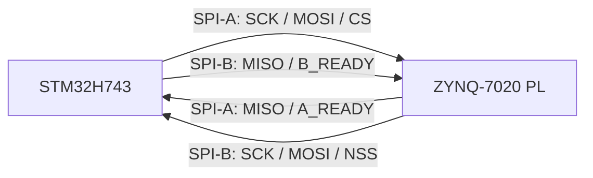

# STM32H743 ↔ ZYNQ-7020 双 SPI 通信接口

> 协议层最新真源为
> `F:\vivadoproject\separation\docs\dual_spi_link_spec_v0.3.md`。
> 本文保留 STM32 工程映射和联调速查信息；若语义冲突，以 v0.3 为准。

> 2026-07-22 配置冻结：SPI-A 使用 `SPI1`（PB3/PB4/PB5），SPI-B 使用
> `SPI6`（PG13/PG12/PG14）和 BDMA；PE2 是 SPI-B 唯一的事务监督输入，
> 不再使用旧的 PB12/PG14 双 NSS 网络。
>
> 2026-07-23 杜邦线上板稳定基线：SPI-A 为 12 MHz、PB3 为
> `GPIO_SPEED_FREQ_LOW`；SPI-B 为 6.25 MHz。该组合已连续交换超过
> 125,000/83,000 页且全部错误计数为 0。24 MHz 不是当前飞线合格频点。

## 1. 当前决策

本项目采用两套相互独立的四线 SPI，并保留每套 SPI 的全双工能力：

- SPI-A：STM32H743 为主机，ZYNQ PL 为从机。
- SPI-B：ZYNQ PL 为主机，STM32H743 为从机。
- 每套 SPI 都使用一个由从机输出的 `READY` 信号。
- 每次事务固定交换一整页数据，主机和从机在同一组时钟下同时发送一页、接收一页。
- 初始联调使用 SPI Mode 0、8 bit、MSB first。
- 第一版 Exchange Page 固定为 1024 byte。

这种结构解决了普通单主机 SPI 的核心限制：STM32 和 FPGA 都可以主动发起一次交换，同时仍可使用 DMA 做连续传输。



## 2. 物理接口

### 2.1 SPI-A：STM32 主机发起

| STM32 引脚 | ZYNQ PL 引脚 | 信号 | 方向（相对 STM32） | 说明 |
|---|---|---|---:|---|
| PB3 | U7 | `SPI1_SCK` | 输出 | SPI-A 时钟 |
| PB4 | T9 | `SPI1_MISO` | 输入 | PL 同步返回页面 |
| PB5 | U10 | `SPI1_MOSI` | 输出 | STM32 发送页面 |
| PB6 | V7 | `ZYNQ_SPI_A_CS` | 输出 | 软件片选，空闲为高 |
| PB7 | Y6 | `ZYNQ_SPI_A_READY` | EXTI7 上升沿输入 | PL 从机已经准备好 RX/TX Exchange Page |

STM32 配置：

- SPI1 Full-Duplex Master
- 软件 NSS，PB6 单独作为 GPIO 控制
- Mode 0：CPOL=0、CPHA=0
- 8 bit、MSB first
- SPI123 内核时钟为 192 MHz
- 当前 `.ioc` 分频为 16，SCK 为 12 MHz；PB3/SCK 使用 `GPIO_SPEED_FREQ_LOW`
- RX：DMA1 Stream1
- TX：DMA1 Stream2

### 2.2 SPI-B：ZYNQ PL 主机发起

| STM32 引脚 | ZYNQ PL 引脚 | 信号 | 方向（相对 STM32） | 说明 |
|---|---|---|---:|---|
| PG13 | Y7 | `SPI6_SCK` | 输入 | PL 输出的 SPI-B 时钟 |
| PG12 | W8 | `SPI6_MISO` | 输出 | STM32 同步返回页面 |
| PG14 | Y9 | `SPI6_MOSI` | 输入 | PL 发送页面 |
| PE2 | Y8 | `ZYNQ_SPI_B_NSS` | 双边沿 EXTI2 输入 | PL 事务边沿监督；不是 SPI6 硬件 NSS |
| PE6 | V8 | `ZYNQ_SPI_B_READY` | 输出 | STM32 已经挂好 SPI6 BDMA 页面 |

STM32 配置：

- SPI6 Full-Duplex Slave
- 软件 NSS；PE2 仅用于事务边沿监督，IRQ 优先级 5
- Mode 0：CPOL=0、CPHA=0
- 8 bit、MSB first
- RX：BDMA Channel0
- TX：BDMA Channel1

### 2.3 GPIO 默认状态

| 信号 | 上电状态 | 原因 |
|---|---|---|
| `ZYNQ_SPI_A_READY` | 下拉、上升沿 EXTI7 | FPGA 未启动时禁止 STM32 误发事务；任务启动 DMA 前再次读电平 |
| `ZYNQ_SPI_A_CS` | 高 | SPI-A 默认不选中 |
| `ZYNQ_SPI_B_READY` | 低 | STM32 尚未挂好 SPI6 BDMA 时禁止 PL 发起 |
| `ZYNQ_SPI_B_NSS` | 上拉、双边沿 EXTI2 | 下降沿撤销 READY 并开始计时；上升沿检查 EOT 和 BDMA 剩余量 |
| `SPI6_SCK`、`SPI6_MOSI` | 下拉 | PL 未启动时保持 Mode 0 空闲状态 |

## 3. 电气要求

- STM32 与 ZYNQ 必须共地。
- 必须确认 ZYNQ 所在 PL Bank 的 `VCCO` 与 STM32 GPIO 电平兼容。
- 如果 PL Bank 为 1.8 V，不能直接连接到 STM32 的 3.3 V 输出，必须使用合适的电平转换。
- 建议在每个高速输出的驱动端预留 22 Ω～47 Ω 串联电阻位置，首版可使用 33 Ω；SPI-A 优先在 PB3/SCK 发送端串联 22 Ω～33 Ω。
- 当前杜邦线稳定配置为 SPI-A 12 MHz、PB3 `LOW`；SPI-B 为 6.25 MHz。
- SPI-A 24 MHz 在 PB3 `MEDIUM` 时出现极低概率位滑移，在 PB3 `LOW` 时出现约 0.81% 的页头 CRC 错误，因此不得作为当前交付频点。
- 重新测试 24/48 MHz 前，必须缩短飞线、至少使用两根就近 GND，并在 PB3 靠近 STM32 端串联 22 Ω～33 Ω；每一档都必须检查 SCK、CS 和数据的波形与时序裕量。
- 两套 SPI 均保持二线全双工模式，不在运行中切换为 simplex TX/RX。

## 4. READY 与事务规则

`READY` 始终由从机控制，表示“从机已经准备好同时接收和发送一整页”。

### 4.1 SPI-A

1. PL 准备好 SPI-A 的 1024-byte RX buffer 和 TX buffer。
2. PL 将 `A_READY` 拉高。
3. STM32 检测到 `A_READY=1` 后，将 PB6 拉低。
4. STM32 调用 SPI1 全双工 DMA，固定交换 1024 byte。
5. DMA 完成且 SPI 不再 Busy 后，STM32将 PB6 拉高。
6. PL 完成 CRC/序号检查，准备下一组 buffer。
7. PL 必须让 `A_READY` 至少经历一次低电平，再为下一页重新拉高。

### 4.2 SPI-B

1. STM32 为 SPI6 挂好位于 `RAM_D3` 的 1024-byte RX BDMA 和 TX BDMA 页面。
2. STM32 将 `B_READY` 拉高。
3. PL 检测到 `B_READY=1` 后，将 PE2/NSS 拉低；STM32 EXTI2 立即将 `B_READY` 拉低。
4. PL 固定产生 1024 byte 的时钟并完成全双工交换。
5. PL 将 NSS 拉高。
6. PE2 上升沿检查 SPI6 `EOT` 或 RX/TX BDMA 均已归零；否则记为 `EARLY_NSS`，丢弃半页并在任务上下文 Abort/DeInit/Init SPI6。
7. STM32 DMA 完成回调只清事件和 `B_READY`，协议解析放到 FreeRTOS 任务中。
8. STM32准备好下一组 buffer 后，再次将 `B_READY` 拉高。

主机不得仅根据 READY 的持续高电平连续启动两次事务；必须观察到 READY 的低到高重新武装过程。

## 5. Exchange Page v1

### 5.1 固定大小

```text
EXCHANGE_PAGE_BYTES = 1024
HEADER_BYTES        = 32
PAYLOAD_BYTES_MAX   = 988
PAGE_CRC_BYTES      = 4
```

所有多字节整数使用小端序。禁止直接把未固定 packing 的 C 结构体或 SystemVerilog packed struct 原样当作线协议；两端必须按字段偏移显式序列化。

### 5.2 页面布局

| Offset | Size | 字段 | 说明 |
|---:|---:|---|---|
| 0 | 4 | `magic` | 固定字节 `"DSP1"`；按 little-endian `uint32_t` 为 `0x31505344` |
| 4 | 1 | `version_major` | 第一版固定为 1 |
| 5 | 1 | `header_bytes` | 固定为 32 |
| 6 | 1 | `link_id` | 0=SPI-A，1=SPI-B |
| 7 | 1 | `page_flags` | ACK、重传、复位、错误等 |
| 8 | 4 | `tx_sequence` | 本发送方向、本物理链路的页面序号 |
| 12 | 4 | `rx_result_sequence` | `RX_RESULT_VALID=1` 时被 ACK/NACK 的序号 |
| 16 | 2 | `payload_bytes` | 有效 payload 长度，范围 0～988 |
| 18 | 2 | `message_count` | payload 中 TLV 消息个数 |
| 20 | 4 | `sender_time_us` | 发送端微秒时间戳，允许自然回绕 |
| 24 | 2 | `status_code` | 统一状态或错误码 |
| 26 | 2 | `rx_credit_pages` | 接收端还能接受的页面数量；第一阶段使用 0 或 1 |
| 28 | 4 | `header_crc32c` | CRC-32C，覆盖 byte 0～27 |
| 32 | 988 | `payload` | TLV 消息区，未使用字节必须填 0 |
| 1020 | 4 | `page_crc32c` | CRC-32C，覆盖 byte 0～1019 |

CRC 使用 CRC-32C/Castagnoli：

- reflected polynomial：`0x82F63B78`
- init：`0xFFFFFFFF`
- xorout：`0xFFFFFFFF`
- CRC 字段按 little-endian 存放

### 5.3 `page_flags`

| Bit | 名称 | 含义 |
|---:|---|---|
| 0 | `ACK_ONLY` | 本页没有业务 TLV，仅用于 ACK/credit/heartbeat 或 RESET |
| 1 | `RETRANSMIT` | 本页是之前序号的重传 |
| 2 | `RESET_EPOCH` | 发送端刚复位，要求重新建立序号状态 |
| 3 | `ERROR` | 有效 result 的 `status_code` 非零 |
| 4 | `MORE_FRAGMENTS` | v0.3 固定为 0 |
| 5 | `TX_SEQUENCE_VALID` | 本页参与序号、ACK 和 outstanding |
| 6 | `RX_RESULT_VALID` | `rx_result_sequence/status_code` 有效 |
| 7 | Reserved | 发送为 0 |

## 6. Payload TLV

每条消息使用固定 8-byte 头：

| Offset | Size | 字段 | 说明 |
|---:|---:|---|---|
| 0 | 2 | `type` | 消息类型 |
| 2 | 2 | `flags` | 消息级标志 |
| 4 | 2 | `length` | 消息 body 的有效字节数，不含 TLV 头和 padding |
| 6 | 2 | `tag` | 请求/响应关联号或分片编号 |
| 8 | N | `body` | 消息内容 |

每条 TLV 按 4 byte 边界补 0。未知 `type` 在长度合法时必须跳过，而不是让整条链路失败，这样以后可以增加消息而不破坏旧固件。
`type=0xFFFF` 永久保留，发送端必须拒绝，接收端必须返回 `BAD_TLV`。

建议的类型空间：

| 范围 | 用途 |
|---|---|
| `0x0000～0x00FF` | 链路控制、心跳、能力查询 |
| `0x0100～0x01FF` | DDS 配置与状态 |
| `0x0200～0x02FF` | ADC 配置、ADC 样本块 |
| `0x0300～0x03FF` | 通用控制量、比赛算法结果 |
| `0x7F00～0x7FFF` | 日志与诊断 |
| `0x8000～0xFFFE` | 实验或厂商自定义 |

## 7. 错误与恢复语义

- Magic、版本、Header 长度、Header CRC 或 Page CRC 任意一项失败：丢弃整页，不执行任何有副作用的命令。
- Header CRC 和 Page CRC 都通过后，`BAD_PAYLOAD_LENGTH/BAD_TLV/BAD_FLAGS/BAD_LINK_ID/BAD_CREDIT`
  才能使用可信 `tx_sequence` 建立 NACK。
- CRC 错误页不能建立 result，也不能推进接收序号。
- 普通 ACK_ONLY 不参与序号，也不要求 ACK，避免 ACK-of-ACK。
- 收到重复的有效 `tx_sequence`：不得重复执行命令，但应再次返回 result。
- 第一阶段每条物理链路只允许一个未确认页面，`rx_credit_pages` 使用 0/1。
- ACK 表示完整页面已经通过校验并原子复制进协议 RX Page Mailbox，不表示业务执行完成。
- RX Page Mailbox 被占用时必须发送 `rx_credit_pages=0`；应用释放整页后才恢复为 1。
- 物理 DMA 完成不释放 sequenced TX buffer；matching ACK 后才能复用。
- 超时后主机释放 CS/NSS，并保留原页面用于带 `RETRANSMIT` 标志重发。
- 任一端复位后先保持自身从机 READY 为低，初始化完成后发送 `RESET_EPOCH` 页面。
- 未识别的 `status_code` 或 TLV 类型必须按“可忽略扩展”处理。

## 8. STM32 DMA 与 FreeRTOS 约束

- SPI1 与 SPI6 都使用 `HAL_SPI_TransmitReceive_DMA()`。
- 每个链路至少准备一组 1024-byte RX/TX 静态 buffer；性能阶段改为 ping-pong 双 buffer。
- SPI6 必须先启动 BDMA，最后才拉高 `ZYNQ_SPI_B_READY`。
- ISR/DMA callback 只做：
  - 清 READY；
  - 保存 HAL 状态；
  - 通知对应 FreeRTOS 任务。
- CRC、TLV 解析、DDS 命令执行和 ADC 数据打包全部放在任务上下文。
- SPI-A 两个页面放在 RAM_D2 `.dma_buffer`；SPI-B 两个页面放在 RAM_D3 `.bdma_buffer`，均按 32 byte 对齐。
- 当前工程没有启用 D-Cache；以后如果启用，TX 前必须 Clean，RX 后必须 Invalidate，并保持 cache line 对齐。

每条链路各有一个协议 RX Page Mailbox。物理 DMA 页面完成后，
`dual_spi_session_receive_page()` 只有在下列操作全部成功时才提交序号和成功 ACK：

1. 页面、CRC、TLV 和协议字段完整验证。
2. 整页 metadata 与 payload 已复制进空闲 mailbox。
3. 新 RX sequence 状态可以原子提交。

应用在 `DualSpiTask` 上下文实现：

```c
bool DualSpi_OnPage(dual_spi_link_id_t link_id,
                    const dual_spi_page_view_t *page);
```

- 返回 `true`：应用已经接纳或处理完整页，session 释放 mailbox，后续可广告 `credit=1`。
- 返回 `false`：保留同一页并继续广告 `credit=0`，任务以后再次调用。
- 当前弱默认实现重新遍历所有 TLV、限频输出元数据日志、调用
  `DualSpi_OnTlv()`，然后返回 `true` 释放页面。
- `DualSpi_OnTlv()` 的 `body` 可以是最多 980 byte 的任意二进制数据；若要长期持有，
  回调必须在返回前复制数据。
- 若业务需要“整页队列容量不足就不接纳”的原子背压，应覆盖
  `DualSpi_OnPage()`，先检查整页容量，再决定返回 `true/false`。
- 页面可包含多条 TLV；若要转交给其他任务，应保证整页接纳是原子的。

发送接口 `DualSpi_Send()` 的 `SEND_OK` 只表示消息进入本地两槽发送 mailbox，
不表示对端 ACK 或业务完成。端到端完成应使用相同 `tag` 的响应 TLV。

### 8.1 USART1 运行日志

- USART1 使用 PA9/PA10、115200 baud、8N1。
- 默认 `g_uart_mode=UART_MODE_LOG`，上电后直接输出双 SPI 日志。
- SPI/DMA/EXTI 中断不直接发送串口；`DualSpiTask` 只进行非阻塞日志入队。
- 日志队列已满时丢弃日志而不阻塞通信，并在周期统计中报告 `log-drop`。
- 每秒输出每条链路的物理层和协议层累计统计；TLV 明细最多输出 8 条/秒。
- `type=0x7F00` 约定为 UTF-8/ASCII 诊断文本，STM32 会额外输出最多 64 byte 的可打印预览。

典型日志：

```text
dualspi init=ok page=1024 spi1=12MHz spi6=slave nss=PE2 bdma=ch0/ch1
dualspi B EARLY_NSS rx-rem=768 tx-rem=512
dualspi B recovery=ok
dualspi A tlv type=0x0301 tag=7 len=16
dualspi A phy st=3 start=120 done=119 err=1 to=0 early=0 rec=1
```

## 9. 吞吐量目标

1024-byte 页面中有 988 byte 业务 payload，线协议效率约为 96.5%，以下数值未扣除页面间空隙和软件调度时间：

| SCK | 原始吞吐 | 理论 payload 吞吐 | 单页时间 |
|---:|---:|---:|---:|
| 8 MHz | 1.000 MB/s | 0.965 MB/s | 1024.00 µs |
| 12 MHz | 1.500 MB/s | 1.447 MB/s | 682.67 µs |
| 24 MHz | 3.000 MB/s | 2.895 MB/s | 341.33 µs |
| 48 MHz | 6.000 MB/s | 5.789 MB/s | 170.67 µs |
| 96 MHz | 12.000 MB/s | 11.578 MB/s | 85.33 µs |

当前 TIM6 为 64 MHz / 80，即理论触发频率 800 kHz。若 ADC1 和 ADC2 都连续输出 16-bit 原始数据，总数据率约为 3.2 MB/s：

- 当前 12 MHz 档适合可靠控制、中速数据和继续开发；它不是连续双 ADC 原始流的最终吞吐档。
- 24 MHz 的理论 payload 吞吐低于连续双 ADC 的 3.2 MB/s 原始数据率。
- 当前 `.ioc` 为 12 MHz（理论单链路 payload 1.447 MB/s）；48 MHz 的理论值为 5.789 MB/s，但在完成硬件信号完整性整改前不得启用。
- 若实测不能持续承载两路原始 ADC，应启用 Release 优化、ping-pong buffer，或在 STM32 侧降采样、分帧或压缩。

2026-07-23 杜邦线实测（固定 1024-byte 页面，包含页面 envelope）：

| 链路 | SCLK | 实测页率 | 实测线速率 | 120 秒观察结果 |
|---|---:|---:|---:|---|
| SPI-A | 12 MHz | 约 745 page/s | 约 6.10 Mbit/s | 最终 `valid=125159 err=0` |
| SPI-B | 6.25 MHz | 约 497 page/s | 约 4.07 Mbit/s | 最终 `valid=83448 err=0` |

两条链路当前实测聚合线速率约 10.17 Mbit/s；业务净吞吐还要扣除 32-byte
header、4-byte page CRC、TLV header 和空页面。

## 10. 当前 STM32CubeMX/STM32CLI 状态

硬件真源：

```text
F:\STM32\RTOS_DDS_ADCs_CMAKE\RTOS_DDS_ADCs_CMAKE.ioc
```

修改前快照：

```text
F:\STM32\RTOS_DDS_ADCs_CMAKE\RTOS_DDS_ADCs_CMAKE.pre-dual-spi-20260718.ioc.bak
```

项目专用 STM32CLI 配置：

```text
F:\STM32\RTOS_DDS_ADCs_CMAKE\stm32cli.config.json
```

验证命令：

```powershell
stm32cli --config F:\STM32\RTOS_DDS_ADCs_CMAKE\stm32cli.config.json --json ioc-check

# CubeMX 6.17 CLI 在该项目会把验证生成物输出到顶层 Src/ 与 Inc/；
# 正式 CMake 仍构建 Core/Src 与 Core/Inc。生成后必须审查差异并受控合并，
# 不要把顶层 Src/Inc 当作已自动生效的构建树。
stm32cli --config F:\STM32\RTOS_DDS_ADCs_CMAKE\stm32cli.config.json generate

stm32cli --config F:\STM32\RTOS_DDS_ADCs_CMAKE\stm32cli.config.json configure
stm32cli --config F:\STM32\RTOS_DDS_ADCs_CMAKE\stm32cli.config.json build
```

当前已验证：

- `.ioc` 检查通过。
- PB7 已配置为上升沿 EXTI7，优先级 5；PE2 已配置为双边沿 EXTI2，优先级 5。
- SPI1 当前为 master、Mode 0、prescaler 16，即 12 MHz；SPI6 当前为 slave、Mode 0、软件 NSS。
- SPI-B 提前释放 PE2/NSS 会记录 RX/TX BDMA 剩余量，关闭 READY，丢弃半页并在任务上下文执行 Abort/DeInit/Init 恢复。
- USART1 默认进入 LOG 模式；双 SPI 日志非阻塞入队并带明细限频与每秒累计统计。
- 默认 `DualSpi_OnPage()` 已能遍历任意二进制 TLV，并调用可覆盖的 `DualSpi_OnTlv()`。
- CubeMX 6.17 可以正确解析两套 SPI、GPIO、DMA、EXTI 和 NVIC 配置。
- `Core/Src/spi.c`、`Core/Inc/spi.h`、`Core/Src/bdma.c` 和全部中断代码已同步到正式构建树。
- CMake Debug 构建通过。
- ELF 中存在 SPI1/SPI6 初始化、BDMA IRQ 和 SPI6 IRQ 符号。
- `dual_spi_protocol/session/transport` 三组 Windows 主机测试与 ARM GCC 构建通过；
  测试已覆盖 `type=0xFFFF` 接收拒绝、CRC 可信错误 NACK、CRC 错误不回 NACK、
  `EARLY_NSS` 不发布半页以及迟到 DMA callback 被忽略。
- 2026-07-23 构建通过：`DTCMRAM=32848 B`、`RAM_D2=10048 B`、
  `RAM_D3=2048 B`、`FLASH=99424 B`。SPI-B 两个页面仍位于 RAM_D3。
- PL 行为仿真已通过 16 项 fixed-frame 链路测试、21 页 validator 协议测试、
  SPI-A 两页 1024 byte/64.5 MHz 和 SPI-B 两页 1024 byte/50 MHz 测试。
- PL 200 MHz OOC route 后全设计 `WNS=+0.230 ns`、`WHS=+0.049 ns`；
  SPI-A/SPI-B PHY→validator 分路 WNS 分别为 `+0.269 ns`、`+0.367 ns`。
- 当前 OOC 结果不是最终板级签核；最终 BD、引脚、IOSTANDARD、input/output delay
  和 `HD.CLK_SRC` 尚未冻结。
- 2026-07-23 已经通过 ST-LINK（SWD、3.11 V）烧录并校验成功；COM7/115200
  完成双链路观察。12/6.25 MHz 下 30 秒首轮和随后 120 秒耐久测试均为零错误；
  SPI、DMA、timeout、early-NSS、recovery、CRC、duplicate 和 gap 计数均未增长。
- 120 秒串口证据位于
  `artifacts\20260723-163347-141-serial\serial.log`；烧录首轮证据位于
  `artifacts\20260723-163255-998-flash-and-observe\serial.log`。

工程顶层 `Src/`、`Inc/` 是 CubeMX 6.17 CLI 的验证生成物，不参与当前 CMake 构建；当前有效构建树是 `Core/Src/`、`Core/Inc/`。不要手工复制整棵目录或覆盖含用户代码的文件。

## 11. 后续实现顺序

1. 保持当前 12/6.25 MHz 固件与 bitstream 作为杜邦线回归基线，不在运行时动态切频。
2. 在 PB3 靠近 STM32 端串联 22 Ω～33 Ω、缩短 SCK 飞线并补足就近 GND；用示波器确认过冲、振铃和边沿后再测 SPI-A 24 MHz。
3. 只有 24 MHz 长时间零错误后才资格测试 48 MHz；失败时立即回到 12 MHz 基线。
4. 执行 CRC/长度/提前 NSS/READY 抖动/复位错误注入和多小时双向满载测试。
5. 冻结 DDS 命令、ADC 样本块和算法结果的业务 TLV body，并用相同 `tag` 返回业务响应。


